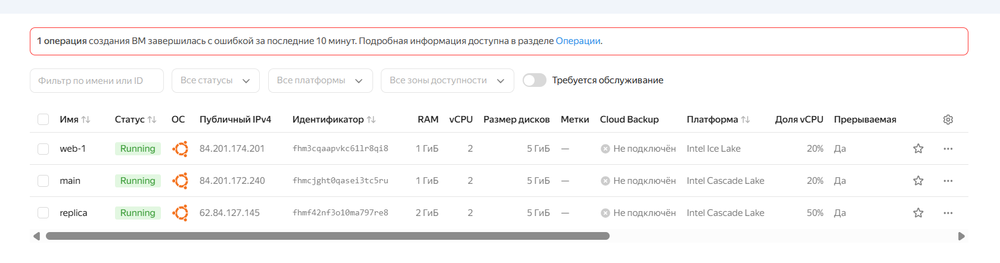
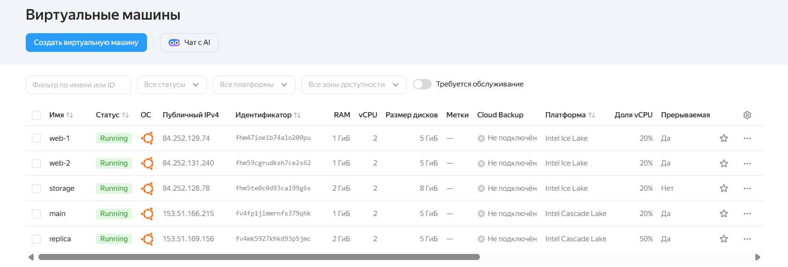
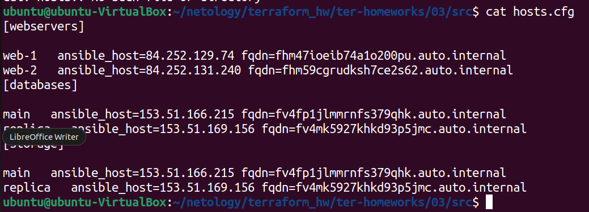

# netology_terraform_manage_construct_hw
Домашнее задание к занятию «Управляющие конструкции в коде Terraform»

# Задание 1


# Задание 2
В личном кабинете Yandex Cloud вижу, что у меня лимит по vCPU: всего доступно 6 (?) (```Количество vCPU виртуальных машин в одной зоне доступности
compute.instanceCores.count.ru-central1-*``` равно 2 (https://yandex.cloud/ru/docs/compute/concepts/limits)). Между тем, когда я создаю 4 ВМ, в каждой из них используется не менее двух vCPU (связано с архитектурой, количество ядер должно быть кратно двум, при использовании 1 при создании проекта вылетает ошибка, что это недопустимое значение; это верно для всех платформ standard-v1/2/3).


Ошибка:
> The limit on maximum number of cores has exceeded for zone "ru-central1-a"
Что пришлось по итогу сделать:
* отправить запрос на увеличение квоты на моём облаке (было доступно создание только двух сетей, одна из которых "default" и к ней, кажется, нельзя обращаться из файлов Terraform; запросила три)
* ВМ из **for_each** разместила в ru-central1-d, для этого создала новый ресурс типа "yandex_vpc_subnet"; в итоге к ним неприменимы группы безопасности, созданные в задаче 1, это минус.
* все остальные ВМ находятся в ru-central1-a, и таким образом я укладываюсь в лимиты.

Альтернативой было бы запросить увеличение квоты на количество vCPU в зоне. 

# Задание 3

# Задание 4
Все ВМ и диски успешно созданы:


Содержимое файла ```hosts.cfg```:



