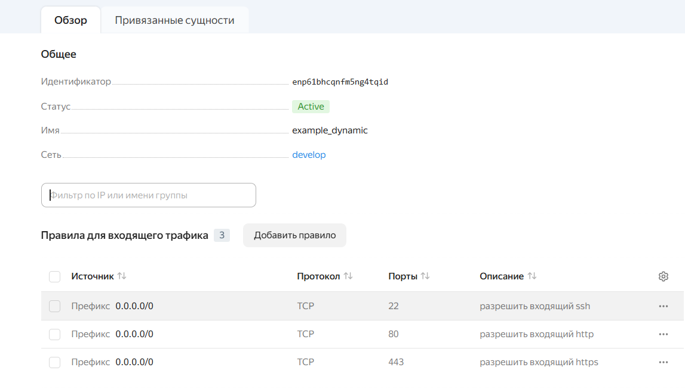
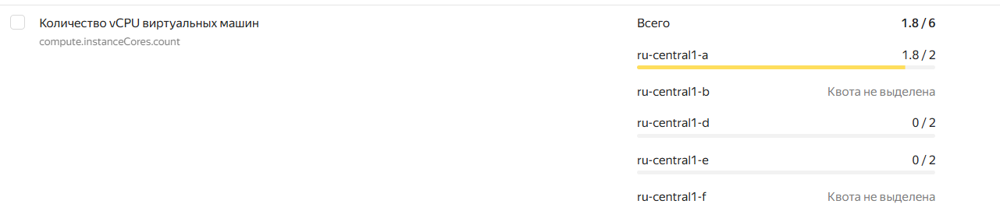
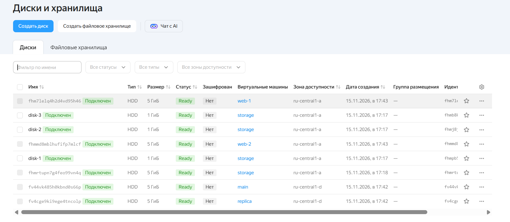

# netology_terraform_manage_construct_hw
Домашнее задание к занятию «Управляющие конструкции в коде Terraform»

# Задание 1
Правила для созданной группы безопасности:


Предварительно пришлось ещё поправить ```variables.tf``` и ```providers.tf```, чтобы отключить авторизацию по OAuth-токену (она перестала действовать ещё летом 2026). 

# Задание 2
В личном кабинете Yandex Cloud вижу, что у меня лимит по vCPU: всего доступно 6 (?) (```Количество vCPU виртуальных машин в одной зоне доступности
compute.instanceCores.count.ru-central1-*``` равно 2 (https://yandex.cloud/ru/docs/compute/concepts/limits)). Между тем, когда я создаю 4 ВМ, в каждой из них используется не менее двух vCPU (связано с архитектурой, количество ядер должно быть кратно двум, при использовании 1 при создании проекта вылетает ошибка, что это недопустимое значение; это верно для всех платформ standard-v1/2/3).


Ошибка:
> The limit on maximum number of cores has exceeded for zone "ru-central1-a"

Что пришлось по итогу сделать:
* отправить запрос на увеличение квоты на моём облаке (было доступно создание только двух сетей, одна из которых "default" и к ней, кажется, нельзя обращаться из файлов Terraform, во всяком случае при попытке написать ```yandex_vpc_network.default.id``` (без предварительного описания в ```main.tf```) Terraform воспринимает её как необъявленную; запросила три)
* ВМ из **for_each** разместила в ru-central1-d, для этого создала новый ресурс типа "yandex_vpc_subnet"; в итоге к ним неприменимы группы безопасности, созданные в задаче 1, это минус.
* все остальные ВМ находятся в ru-central1-a, и таким образом я укладываюсь в лимиты.

Альтернативой было бы запросить увеличение квоты на количество vCPU в зоне. 

# Задание 3
disk_vm.tf
```
resource "yandex_compute_disk" "disks" {
  name = "disk-${count.index + 1}"
  type = "network-hdd"
  size = 1
  count = 3
  block_size = 4096
}

resource "yandex_compute_instance" "storage" {
  name = "storage"
  zone = "ru-central1-a"
  platform_id = "standard-v3"

  resources {
    cores  = 2
    memory = 2
    core_fraction = 20
  }

  boot_disk {
    initialize_params {
      image_id = data.yandex_compute_image.ubuntu.image_id
      type     = "network-hdd"
      size     = 5
    }
  }
  metadata = {
      ssh-keys           = "ubuntu:${local.ssh-keys}"
      serial-port-enable = "1"
  }
  network_interface {
    subnet_id = yandex_vpc_subnet.develop.id
    nat       = true
    security_group_ids = [
      yandex_vpc_security_group.example.id
    ]
  }
  dynamic "secondary_disk" {
    for_each = yandex_compute_disk.disks.*.id
    content {
      disk_id = secondary_disk.value
    }
  }
}
```

# Задание 4
Все ВМ и диски успешно созданы:



Содержимое файла ```hosts.cfg```:


Код проекта залила в ветку **terraform-03**.

# Задание 8*
Ошибка:
> Call to function "templatefile" failed: ./hosts.tftpl:24,85-86: Invalid character; This character is not used within the language., and 1 other diagnostic(s).

Открыла файл в текстовом редакторе Sublime Text, он показал, что искомые символы это **=${**. Судя по всему, дело в лишней фигурной скобке в конце строки. И ещё в незакрытой фигурной скобке после ```"nat_ip_address"```, а также виноват лишний пробел в "provider_id ". 
После этого ```terraform apply``` удался. В hosts.cfg:
> [webservers]web-1 ansible_host=84.252.129.74 platform_id=standard-v3web-2 ansible_host=84.252.131.240 platform_id=standard-v3
